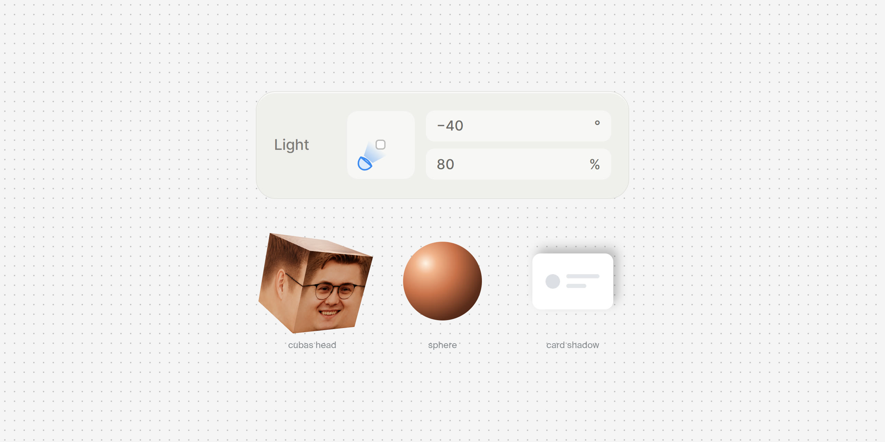
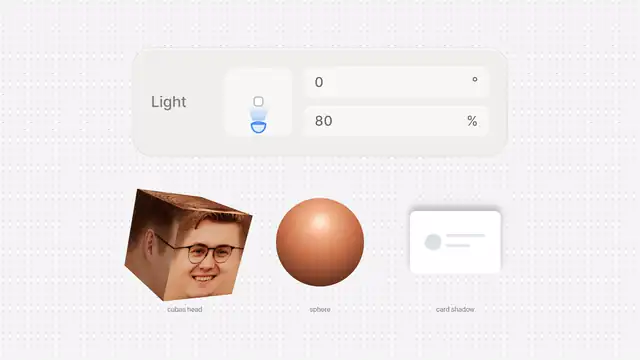

<p align="center">
  
</p>

<p align="center">
  <a href="https://likemiens.com/ui/light-dial"><b>Live demo</b></a> ·
  <a href="media/demo.mp4"><b>Video</b></a> ·
  <a href="#quick-start"><b>Quick start</b></a>
</p>

<p align="center">
  Made by Likemiens ·
  <a href="https://x.com/a_varantsov">X</a> ·
  <a href="https://t.me/Likemiens">Telegram</a> ·
  <a href="https://github.com/Likemiens">GitHub</a>
</p>

**Light Dial** is a small control for the light in a scene: where the light comes from and how strong it is. It is the light control of [Cubas](https://cubas.likemiens.com), made into one Web Component with no dependencies.

It doesn't light anything by itself. It gives you an angle and a strength, and you pass them to a three.js light, a CSS shadow or anything else.

<p align="center">
  
</p>

## Features

- **Lights anything.** Two numbers out: an angle and a strength. Turn a three.js light, a CSS shadow, a gradient or a canvas with them.
- **One tag, any website.** One small file (~6 KB gzipped). No framework, no build step, no dependencies.
- **Easy to hold.** Drag the lamp, or press where the light should come from. A press on the lamp picks it up where it is, without a jump.
- **Wheel, keys and numbers.** Scroll over the dial, use the arrow keys, or type the angle and the strength. Shift snaps to 15°.
- **Accessible.** A real slider for screen readers, in English or Russian. A bigger dial on touch screens, and fields that don't zoom the page on phones. Respects "reduce motion".
- **Your colors.** CSS custom properties and `::part()`.

## Quick start

Paste this anywhere in your HTML:

```html
<script type="module" src="https://cdn.jsdelivr.net/gh/Likemiens/light-dial@v1.0.0/light-dial.js"></script>

<light-dial angle="0" intensity="80"></light-dial>
<div class="card" style="width: 200px; padding: 24px; border-radius: 12px; background: #fff">A card under the light</div>

<script type="module">
  const dial = document.querySelector("light-dial");
  const card = document.querySelector(".card");

  // The shadow falls away from the lamp, longer and darker as the light grows.
  const light = ({ angle, intensity }) => {
    const a = (angle * Math.PI) / 180;
    const power = intensity / 100;
    const length = 3 + 9 * power;
    card.style.boxShadow =
      `${-Math.sin(a) * length}px ${-Math.cos(a) * length}px ` +
      `${6 + 10 * power}px rgb(0 0 0 / ${0.3 * Math.min(power, 1)})`;
  };

  light(dial.value);                                      // the first shadow
  dial.addEventListener("input", (e) => light(e.detail)); // and every move
</script>
```

Open the page and turn the dial: the shadow follows the lamp.

Or load `https://likemiens.com/ui/light-dial/light-dial.js`: the file the live demo runs, always the latest version.

> [!NOTE]
> The dial is your scene seen from above, with you at the bottom. The square in the middle is the object, and the lamp goes round it. `0°` puts the light in front of the object, `90°` on its right, `±180°` behind it.

### Light a three.js scene

Put your lights in a group round the object, with the key light in front (on +z, where the camera is). Then turn the group:

```js
const rig = new THREE.Group();
const key = new THREE.DirectionalLight(0xffffff, 3);
key.position.set(0, 2, 5);
rig.add(key);
scene.add(rig);

dial.addEventListener("input", ({ detail: { angle, intensity } }) => {
  rig.rotation.y = THREE.MathUtils.degToRad(angle);
  key.intensity = 3 * (intensity / 80); // at 80 % the light is as you set it
});
```

The angle turns the same way three.js counts `rotation.y`, so there is no sign to flip.

### With a bundler

```bash
npm i @likemiens/light-dial
```

```js
import "@likemiens/light-dial"; // registers <light-dial>
```

Import it in the browser only: the module needs `document` when it loads. With server rendering, import it in `useEffect`, `onMounted` or the like.

## Options

Set them as HTML attributes, or as properties with the same names:

| Attribute | Default | What it does |
|---|---|---|
| `angle` | `0` | Where the light comes from, `-180`…`180` degrees. Any number folds into the range: `270` is `-90` |
| `intensity` | `80` | How strong it is, `0`…`150` %. At `0` the lamp is off. A number out of the range shows as an error |
| `label` | `Light` | The name on the left |
| `disabled` | — | Dims the control and ignores input |
| `lang` | page language | `ru` for Russian texts, anything else for English. Taken from the element or its nearest parent with `lang` |
| `state` | — | `hover`, `drag`, `focus` or `typing`: shows that state without a pointer. For previews and screenshots |

## Events

| Event | When | `detail` |
|---|---|---|
| `input` | While the light moves: drag, wheel, keys, typing | `{ angle, intensity }` |
| `change` | When a move ends: the pointer is released, a key steps, a field is left. A good moment to save | `{ angle, intensity }` |

`intensity` in `detail` is always within `0…150`. Setting attributes or properties from code doesn't fire events.

## Styling

Set the colors on the element itself:

```css
light-dial {
  --ld-lamp: #3d8bf2;                 /* the lamp's outline */
  --ld-lamp-fill: #dceafd;            /* the lamp's body */
  --ld-beam: #3d8bf2;                 /* the beam */
  --ld-focus: rgb(12 117 241 / 72%);  /* the focus ring */
}
```

Also: `--ld-ink` (the numbers), `--ld-title` (the label), `--ld-surface` and `--ld-surface-hover` (the dial and the fields), `--ld-line` and `--ld-line-hover` (the dial's edge), `--ld-error`. `--ld-speed` (default `1`) changes how fast the transitions run, and works from any parent too.

The font comes from your page. For full control use `::part()`: `base`, `label`, `dial`, `field`.

## JavaScript API

```js
const dial = document.querySelector("light-dial");

dial.angle = 90;     // the same as the attributes
dial.intensity = 120;
dial.disabled = true;
dial.value;          // { angle, intensity }, what the events carry
```

The module also exports the class and the helper that folds angles:

```js
import { LightDial, wrapAngle } from "@likemiens/light-dial";

wrapAngle(270); // -90
```

Types are in `light-dial.d.ts`: `document.querySelector("light-dial")` and both events come typed.

## Controls

| Input | What it does |
|---|---|
| Drag the lamp | Turns the light. Hold Shift to snap to 15° |
| Press anywhere else on the dial | Puts the lamp there |
| Wheel over the dial | 5° per 100 px of scrolling (with Shift, 3× faster) |
| Arrow keys | 5° (with Shift, 15°) |
| Page Up / Page Down | 45° |
| Home / End | Straight behind the object |
| ↑ ↓ in a field | 1 (with Shift, 10) |
| Enter / Esc in a field | Apply / bring the old value back |

## Browser support

Current Chrome, Edge, Firefox and Safari, on desktop and on phones. The module uses private class methods, so the oldest versions are Chrome and Edge 84, Firefox 90 and Safari 15.

## Files

```
light-dial.js     the component: one ES module, no dependencies
light-dial.d.ts   TypeScript types
example.html      a card and a sphere lit by the dial; open it through any static server
media/            the cover and the demo
```

## Author

Made by **Likemiens**. Say hi or share what you built: [X](https://x.com/a_varantsov) · [Telegram](https://t.me/Likemiens) · [GitHub](https://github.com/Likemiens)

## License

[MIT](LICENSE) © Likemiens
